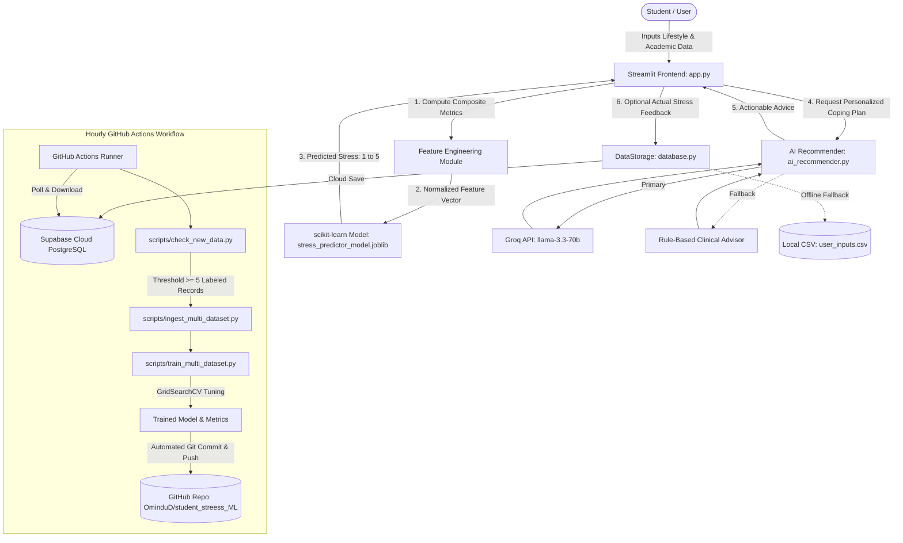

# Portfolio Project Summary: Student Stress Predictor AI

> **Hackathon Note:** This project was originally created for a **Hackathon**, designed as an end-to-end, privacy-focused machine learning and wellness assistance solution addressing student burnout and academic stress.
>
> **Inspection Status:** Generated from direct, comprehensive inspection of the codebase, dependencies, data pipelines, model artifacts, and CI/CD workflows in [github.com/OminduD/student_streess_ML](https://github.com/OminduD/student_streess_ML). Unverified items are marked as "Not found" or "Needs verification."

---

## 1. Project Overview

- **Project Name:** Student Stress Predictor AI (Repository: `student_streess_ML`, in-app title: `StressAI v2.0`)
- **Hackathon Context:** Built during a hackathon to provide a rapid, non-invasive digital mental wellness assessment tool for students navigating academic pressure.
- **Short Description:** An intelligent, full-stack machine learning web application that accurately predicts student stress levels on a 1–5 scale from lifestyle and academic habits, pairing predictions with instant LLM-powered recommendations and continuous MLOps retraining.
- **Main Purpose & Problem Solves:** Academic burnout and stress frequently go unrecognized until severe anxiety, depression, or academic failure occurs. Traditional psychological evaluations can be intimidating, slow, or inaccessible. This project delivers an immediate, anonymous self-assessment interface that maps 5 core lifestyle and academic metrics into an objective stress classification, generates customized coping advice via fast cloud LLMs (or clinical fallbacks), and continuously improves its predictive power through an automated feedback ingestion loop.
- **Key Features:**
  - **Multi-Class ML Stress Classification:** Predicts stress levels (1=Very Low, 2=Low, 3=Moderate, 4=High, 5=Very High) with ~94.2% test accuracy using a tuned Random Forest model ([model/metrics.json:L2-3](file:///home/omindu/Documents/Python/student_streess_ML/model/metrics.json#L2-L3)).
  - **Multi-Provider AI Recommendations:** Pluggable recommendation engine supporting Groq Cloud (`llama-3.3-70b-versatile`), OpenAI, Anthropic, and Hugging Face with automatic degradation to structured rule-based wellness recommendations ([ai_recommender.py:L22-150](file:///home/omindu/Documents/Python/student_streess_ML/ai_recommender.py#L22-L150)).
  - **Real-Time Interactive Analytics Dashboard:** Live visual analytics built with Plotly, providing breakdown distributions of sleep, study loads, headaches, and submission trends over time ([app.py:L1385-1550](file:///home/omindu/Documents/Python/student_streess_ML/app.py#L1385-L1550)).
  - **Continuous MLOps Retraining Loop:** Scheduled GitHub Actions workflow that pulls user-validated contributions from Supabase, checks data sufficiency thresholds, re-trains models with hyperparameter tuning, and commits updated weights back to the repository ([.github/workflows/retrain_model.yml:L1-73](file:///home/omindu/Documents/Python/student_streess_ML/.github/workflows/retrain_model.yml#L1-L73)).
  - **Hybrid Cloud/Local Persistence:** Seamless dual-storage implementation using Supabase PostgreSQL in the cloud and zero-config local CSV fallback (`user_inputs.csv`) ([database.py:L20-137](file:///home/omindu/Documents/Python/student_streess_ML/database.py#L20-L137)).

---

## 2. Technology Stack

### Frontend
- **Streamlit (`>=1.28.0`):** Powers the reactive single-page application and UI controls ([requirements.txt:L14](file:///home/omindu/Documents/Python/student_streess_ML/requirements.txt#L14)).
- **Custom HTML5 & CSS3:** Injected ultra-modern styling featuring glassmorphism, dynamic multi-stop gradient animations, and CSS custom variables ([app.py:L45-887](file:///home/omindu/Documents/Python/student_streess_ML/app.py#L45-L887)).
- **Plotly (`>=5.17.0`):** Interactive histograms, bar charts, and timeline graphs ([requirements.txt:L11](file:///home/omindu/Documents/Python/student_streess_ML/requirements.txt#L11)).
- **Google Fonts CDN:** Remote loading for `Poppins` and `Inter` typography ([app.py:L47](file:///home/omindu/Documents/Python/student_streess_ML/app.py#L47)).
- **Icons8 CDN:** Vector mental health imagery ([app.py:L900](file:///home/omindu/Documents/Python/student_streess_ML/app.py#L900)).

### Backend & Machine Learning
- **Python (`3.10` / `3.11+`):** Core runtime environment ([requirements.txt](file:///home/omindu/Documents/Python/student_streess_ML/requirements.txt), [.github/workflows/retrain_model.yml:L24](file:///home/omindu/Documents/Python/student_streess_ML/.github/workflows/retrain_model.yml#L24)).
- **scikit-learn (`>=1.3.0`):** Machine learning pipeline, `RandomForestClassifier`, `GradientBoostingClassifier`, `GridSearchCV`, and model metrics (`classification_report`, `confusion_matrix`) ([requirements.txt:L5](file:///home/omindu/Documents/Python/student_streess_ML/requirements.txt#L5), [scripts/train_multi_dataset.py:L2-4](file:///home/omindu/Documents/Python/student_streess_ML/scripts/train_multi_dataset.py#L2-L4)).
- **pandas (`>=1.5.0`) & numpy (`>=1.23.0`):** Multi-dataset ingestion, feature harmonization, composite score engineering, and data cleaning ([requirements.txt:L3-4](file:///home/omindu/Documents/Python/student_streess_ML/requirements.txt#L3-L4)).
- **joblib (`>=1.3.0`):** Model serialization for production inference ([requirements.txt:L6](file:///home/omindu/Documents/Python/student_streess_ML/requirements.txt#L6), [app.py:L10](file:///home/omindu/Documents/Python/student_streess_ML/app.py#L10)).
- **requests (`>=2.31.0`):** HTTP client for calling cloud LLM inference APIs ([requirements.txt:L20](file:///home/omindu/Documents/Python/student_streess_ML/requirements.txt#L20)).
- **scipy (`>=1.10.0`):** Statistical analysis and ANOVA testing in exploratory notebooks ([requirements.txt:L30](file:///home/omindu/Documents/Python/student_streess_ML/requirements.txt#L30), [notebooks/multi_dataset_analysis.ipynb](file:///home/omindu/Documents/Python/student_streess_ML/notebooks/multi_dataset_analysis.ipynb)).

### Database & Storage
- **Supabase Cloud Database (`supabase==2.0.3`):** Managed PostgreSQL database accessed via REST API to store continuous user inputs and feedback ([requirements.txt:L17](file:///home/omindu/Documents/Python/student_streess_ML/requirements.txt#L17), [database.py:L14-118](file:///home/omindu/Documents/Python/student_streess_ML/database.py#L14-L118)).
- **Local CSV Storage:** Automatic offline fallback saving submissions to `user_inputs.csv` when Supabase is disconnected ([database.py:L122-137](file:///home/omindu/Documents/Python/student_streess_ML/database.py#L122-L137)).
- **Raw Datasets:** Multi-source survey data:
  - `Student Stress Factors (2).csv`
  - `StressLevelDataset.csv`
  - `Stress_Dataset.csv`

### APIs & External Services
- **Groq Cloud API:** Primary ultra-fast LLM provider (`llama-3.3-70b-versatile` via `https://api.groq.com/openai/v1/chat/completions`) ([ai_config.json:L3-5](file:///home/omindu/Documents/Python/student_streess_ML/ai_config.json#L3-L5)).
- **Alternative LLM Providers:** Optional integration with OpenAI (`gpt-3.5-turbo`), Anthropic (`claude`), Hugging Face Inference API, or custom REST endpoints ([ai_recommender.py:L121-145](file:///home/omindu/Documents/Python/student_streess_ML/ai_recommender.py#L121-L145)).
- **Supabase REST API:** Cloud database operations ([database.py:L59-107](file:///home/omindu/Documents/Python/student_streess_ML/database.py#L59-L107)).

### Authentication & Authorization
- **Anonymous Access with RLS:** Supabase Row-Level Security (RLS) configured to allow anonymous client submissions without collecting PII (Personally Identifiable Information).
- **API Key Management:** Prioritizes Streamlit Secrets (`st.secrets["GROQ_API_KEY"]`), falls back to environment variables (`GROQ_API_KEY`, `AI_API_KEY`), and finally checks local `ai_config.json` ([ai_recommender.py:L50-71](file:///home/omindu/Documents/Python/student_streess_ML/ai_recommender.py#L50-L71)).

### Build Tools & Package Managers
- **Package Management:** `pip` (`requirements.txt`).
- **Environment Management:** Python standard `venv` or `conda` (`studentStress_env`).

### Infrastructure & Deployment Technologies
- **Hosting Platform:** Configured for **Streamlit Community Cloud** ([.streamlit/secrets.toml.example](file:///home/omindu/Documents/Python/student_streess_ML/.streamlit/secrets.toml.example), [README.md:L681-723](file:///home/omindu/Documents/Python/student_streess_ML/README.md#L681-L723)).
- **CI/CD Automation:** GitHub Actions (`.github/workflows/retrain_model.yml`).
- **Containerization (Docker):** Not found (no Dockerfile or docker-compose).

---

## 3. Architecture and Design

### Architectural Style
- **Layered Client-Server Architecture** with an **Automated MLOps Feedback Loop**.
- Integrates a reactive web frontend (Streamlit), modular micro-services for persistence and AI advice, and a scheduled batch background pipeline for continuous retraining.



### Important Architectural Components & Communication
1. **Application Core (`app.py`):**
   - Coordinates session state (`st.session_state`), user interface navigation across 3 pages (`🔮 Predict Stress`, `📊 Statistics`, `ℹ️ About`), feature transformations, prediction triggering, and rendering.
2. **AI Recommendation Engine (`ai_recommender.py`):**
   - Independent recommendation service. Constructs wellness advisor system prompts incorporating the student's 5 parameters and 1 target stress rating, dispatches HTTP requests to LLM APIs, and parses formatted responses.
3. **Data Storage Layer (`database.py`):**
   - Abstracts data persistence. Inspects environment and secrets, connects to Supabase client, validates connection health, and provides read/write methods with seamless fallback to `user_inputs.csv`.
4. **Data Ingestion & Feature Engineering Pipeline (`scripts/ingest_multi_dataset.py`):**
   - Normalizes disparate schemas across multiple survey datasets.
   - Calculates 3 key engineered features:
     - `wellbeing_score = sleep_quality - (headaches_per_week / 2)`
     - `academic_pressure = study_load * (6 - academic_performance)`
     - `total_workload = study_load + (extracurricular_frequency / 2)`
   - Splits data into stratified 80/20 train/test sets.
5. **Model Training & Tuning Pipeline (`scripts/train_multi_dataset.py`):**
   - Compares Random Forest and Gradient Boosting algorithms using 5-fold cross-validated `GridSearchCV` hyperparameter optimization.
   - Generates performance visualizations and exports serialized model artifacts to `model/`.

### Verified Design Patterns in Code
- **Singleton Pattern:** Used in `database.py` via `_storage_instance` and `@st.cache_resource def get_storage()` to maintain a single cached database connection across Streamlit rerun cycles ([database.py:L252-265](file:///home/omindu/Documents/Python/student_streess_ML/database.py#L252-L265)).
- **Strategy / Provider Pattern:** Implemented in `AIRecommendationEngine` to dynamically switch recommendation dispatchers (`_get_groq_recommendations`, `_get_openai_recommendations`, `_get_anthropic_recommendations`, `_get_huggingface_recommendations`) based on configured provider ([ai_recommender.py:L121-150](file:///home/omindu/Documents/Python/student_streess_ML/ai_recommender.py#L121-L150)).
- **Graceful Degradation / Circuit Fallback:**
  - If AI API calls fail (e.g., HTTP 429 quota, 401 invalid key, timeout), the engine falls back to `_fallback_recommendations` ([ai_recommender.py:L151-170](file:///home/omindu/Documents/Python/student_streess_ML/ai_recommender.py#L151-L170)).
  - If Supabase credentials are missing or the connection drops, storage falls back to disk CSV ([database.py:L95-100](file:///home/omindu/Documents/Python/student_streess_ML/database.py#L95-L100)).
- **Cache / Memoization Pattern:** Leverages Streamlit resource caching (`@st.cache_resource`) for model and storage instances and data caching (`@st.cache_data(ttl=60)`) for database queries ([app.py:L808-818](file:///home/omindu/Documents/Python/student_streess_ML/app.py#L808-L818), [app.py:L866-869](file:///home/omindu/Documents/Python/student_streess_ML/app.py#L866-L869)).

### Middleware
- No standard WSGI/ASGI middleware stack (Express/Django) is present; Streamlit operates an internal Tornado/WebSocket server. Execution caching decorators (`@st.cache_resource`, `@st.cache_data`) and session state guards function as execution interceptors.

### Directory Structure & Entry Points
```
student_streess_ML/
├── app.py                          # Primary Web Application Entry Point
├── ai_recommender.py               # AI Recommendation Engine & Fallback Strategy
├── database.py                     # Database Abstraction (Supabase + CSV Fallback)
├── ai_config.json                  # AI Model and Provider Configuration
├── requirements.txt                # Python Dependencies
├── .env.example                    # Template for Environment Secrets
├── .streamlit/
│   └── secrets.toml.example        # Template for Streamlit Cloud Deployment Secrets
├── .github/
│   └── workflows/
│       └── retrain_model.yml       # Hourly Automated Continuous Retraining Workflow
├── scripts/
│   ├── check_new_data.py           # Threshold Gatekeeper for New Training Data
│   ├── download_training_data.py   # Downloader for Cloud Training Feedback
│   ├── ingest_multi_dataset.py     # Multi-Dataset Ingestion & Feature Engineering
│   └── train_multi_dataset.py      # GridSearchCV Model Training & Evaluation
├── model/
│   ├── stress_predictor_model.joblib # Serialized Trained Model
│   ├── metrics.json                # Model Accuracy, Classification Report & Params
│   ├── confusion_matrix.png        # Confusion Matrix Heatmap
│   └── feature_importance.png      # Feature Importance Bar Plot
├── data/
│   └── processed/                  # Combined Dataset & Stratified Splits (X/y train/test)
├── notebooks/
│   └── multi_dataset_analysis.ipynb # Comprehensive EDA, ANOVA Tests & Visualizations
└── user_inputs.csv                 # Local Storage for User Feedback Submissions
```

---

## 4. Deployment and Demo

- **Production Deployment Platform:** Streamlit Community Cloud (configured via `.streamlit/secrets.toml.example` and documentation in [README.md:L681-723](file:///home/omindu/Documents/Python/student_streess_ML/README.md#L681-L723)).
- **Live Website URL:** **Not found** in codebase (Needs verification by repository owner).
- **Demo URL:** **Not found** (Local development URL: `http://localhost:8501`).
- **API Documentation / Base URL:**
  - Groq Cloud API: `https://api.groq.com/openai/v1/chat/completions` ([ai_recommender.py:L305](file:///home/omindu/Documents/Python/student_streess_ML/ai_recommender.py#L305)).
  - Supabase Project URL: Configured via `SUPABASE_URL` environment variable.
- **Hosting & Database Providers:**
  - Web Hosting: Streamlit Community Cloud (free tier supported).
  - Database Hosting: Supabase (managed cloud PostgreSQL).
- **CI/CD Pipeline:**
  - GitHub Actions Workflow: `.github/workflows/retrain_model.yml` scheduled via cron (`0 * * * *`) every hour and manual trigger (`workflow_dispatch`).
- **Containerization:** Not found (no Dockerfile).
- **Required Environment Variables (Secrets):**
  - `GROQ_API_KEY`: API authentication key for Groq Cloud LLM.
  - `SUPABASE_URL`: HTTPS URL of the Supabase PostgreSQL instance.
  - `SUPABASE_KEY`: Anon / public API key for Supabase access.
  - *(Optional)*: `OPENAI_API_KEY`, `ANTHROPIC_API_KEY`, or `AI_API_KEY`.

> **Hosting Recommendation:** Since the project uses Streamlit with custom CSS and lightweight model inference, it can be deployed for free on **Streamlit Community Cloud** with secrets added in the dashboard, or packaged in a single Dockerfile for deployment to **Render**, **Railway**, or **Hugging Face Spaces (Streamlit SDK)**.

---

## 5. Design and Theme

- **UI Framework:** Streamlit UI Components (`st.slider`, `st.metric`, `st.radio`, `st.columns`, `st.expander`, `st.button`).
- **Styling Approach:** Custom Vanilla CSS injected via `st.markdown("<style>...</style>", unsafe_allow_html=True)` ([app.py:L45-887](file:///home/omindu/Documents/Python/student_streess_ML/app.py#L45-L887)).
- **Theme Style:** Ultra-Modern Dark Mode with Glassmorphism (`backdrop-filter: blur(25px) saturate(180%)`) and dynamic animations.
- **Color Palette:**
  - Background Gradient: `linear-gradient(-45deg, #1a1d29, #2d1b2e, #1e2837, #252134)` ([app.py:L32](file:///home/omindu/Documents/Python/student_streess_ML/app.py#L32))
  - Main Container: `rgba(30, 35, 45, 0.9)` ([app.py:L33](file:///home/omindu/Documents/Python/student_streess_ML/app.py#L33))
  - Card Background: `rgba(40, 45, 60, 0.85)` ([app.py:L36](file:///home/omindu/Documents/Python/student_streess_ML/app.py#L36))
  - Card Border: `rgba(255, 255, 255, 0.1)` ([app.py:L37](file:///home/omindu/Documents/Python/student_streess_ML/app.py#L37))
  - Primary Text: `#e4e6eb` ([app.py:L34](file:///home/omindu/Documents/Python/student_streess_ML/app.py#L34))
  - Secondary Text: `#b8bdc8` ([app.py:L35](file:///home/omindu/Documents/Python/student_streess_ML/app.py#L35))
  - Accent 1 (Soft Blue): `#64b5f6` ([app.py:L38](file:///home/omindu/Documents/Python/student_streess_ML/app.py#L38))
  - Accent 2 (Teal): `#4db6ac` ([app.py:L39](file:///home/omindu/Documents/Python/student_streess_ML/app.py#L39))
  - Accent 3 (Warm Amber): `#ffb74d` ([app.py:L40](file:///home/omindu/Documents/Python/student_streess_ML/app.py#L40))
  - Success / Low Stress (Emerald): `#10b981`
  - Warning / Moderate Stress: `#ffb74d`
  - Critical / High Stress (Coral Red): `#ef4444`
  - Royal Purple Accent: `#9333ea` / `#a855f7`
- **Typography:** Google Fonts `'Poppins', 'Inter', sans-serif` ([app.py:L47](file:///home/omindu/Documents/Python/student_streess_ML/app.py#L47)).
- **Icons & Visuals:** Icons8 mental health vector CDN (`https://img.icons8.com/fluency/96/000000/mental-health.png`), native Unicode emojis, and keyframe animations (`gradientShift`, `float`, `pulse`, `bounce`, `fadeInScale`, `slideInUp`).
- **Main Theme Configuration Location:** [app.py:L30-887](file:///home/omindu/Documents/Python/student_streess_ML/app.py#L30-L887).

### How to Extract the Theme for Portfolio Reuse:
1. Open [app.py:L32-43](file:///home/omindu/Documents/Python/student_streess_ML/app.py#L32-L43) to retrieve the raw hex and rgba theme variables (`bg_gradient`, `accent_1`, `accent_2`, `accent_3`, `card_bg`, `container_bg`).
2. Copy the CSS `:root` variable block and `.glass-card` styling from [app.py:L50-155](file:///home/omindu/Documents/Python/student_streess_ML/app.py#L50-L155) into your portfolio CSS stylesheet (`index.css` or Tailwind config).
3. The `@keyframes` animation definitions (`gradientShift`, `float`, `pulse`) can be copied verbatim into any CSS framework to replicate the animated dark mode aesthetic.

---

## 6. Portfolio Summary

**Student Stress Predictor AI**  
*Originally created for a Hackathon.* An intelligent full-stack machine learning web application that accurately predicts student stress levels on a 1–5 scale from academic and lifestyle inputs, providing personalized AI-driven wellness advice and continuous model retraining via an hourly MLOps pipeline.

- **Tech Stack:** Python, Streamlit, scikit-learn, pandas, numpy, Plotly, Groq API (LLaMA 3.3 70B), Supabase (PostgreSQL), GitHub Actions
- **Architecture:** Layered Client-Server Monolith with External LLM Services and Automated Continuous Retraining MLOps Pipeline
- **Design Patterns:** Singleton (Database Connection Pool), Strategy / Provider (Multi-LLM Dispatcher), Fallback / Circuit Breaker (Offline CSV and Clinical Rule Fallback), Memoization (Streamlit Cache)
- **Middleware:** Streamlit execution caching decorators (`@st.cache_resource`, `@st.cache_data`) and session state interceptors
- **Database:** Supabase Cloud Database (PostgreSQL) with automated local CSV fallback (`user_inputs.csv`)
- **Deployment:** Streamlit Community Cloud (configured in `.streamlit/secrets.toml.example`); Live URL: *Not found / Needs verification*
- **Demo:** *Not found / Needs verification* (Local: `http://localhost:8501`)
- **Theme:** Ultra-Modern Glassmorphic Dark Mode with custom CSS gradients and keyframe animations ([app.py:L30-887](file:///home/omindu/Documents/Python/student_streess_ML/app.py#L30-L887))

### Key Features:
- **High-Accuracy ML Predictions:** Achieves ~94.2% test accuracy across 5 distinct stress levels using a GridSearchCV-tuned Random Forest classifier trained on composite student survey data.
- **Fast, Contextual AI Coping Recommendations:** Leverages Groq Cloud LLaMA-3.3-70B for instant, empathetic lifestyle recommendations, paired with a resilient clinical rule-based engine when offline.
- **Automated MLOps Continuous Retraining:** Scheduled GitHub Actions workflow continuously harvests user feedback from Supabase, checks data sufficiency, retrains models, and updates repository weights automatically.
- **Interactive Visual Analytics:** Real-time dashboards visualizing sleep quality, study workload, headaches, and historical submission timelines with Plotly charts.
- **Privacy-Preserving & Dual-Storage:** Anonymous client submissions with no personal identity tracking, supporting cloud database synchronization or standalone offline CSV operation.

### Technical Highlights:
- **Domain-Specific Feature Engineering:** Implements mathematical domain heuristics (`wellbeing_score`, `academic_pressure`, `total_workload`) that elevate model discriminative power between stress classes.
- **Multi-Dataset Schema Harmonization:** Ingests and aligns 4 heterogeneous student surveys into a unified feature space with automatic value normalization and scale inversion.

---

## 7. Items to Verify Manually
1. **Live Deployment URL:** Verify if a live instance is actively hosted on Streamlit Cloud (e.g., `https://<your-subdomain>.streamlit.app`).
2. **Demo Link / Video:** Confirm if a demo recording or interactive preview link exists for your portfolio showcase.
3. **Supabase Production Instance:** Confirm that the live Supabase project URL and anon keys are populated in your Streamlit Cloud secrets management console.
4. **Hackathon Name & Award:** Add the specific hackathon name, date, track, and any awards/recognition earned to the portfolio card.
