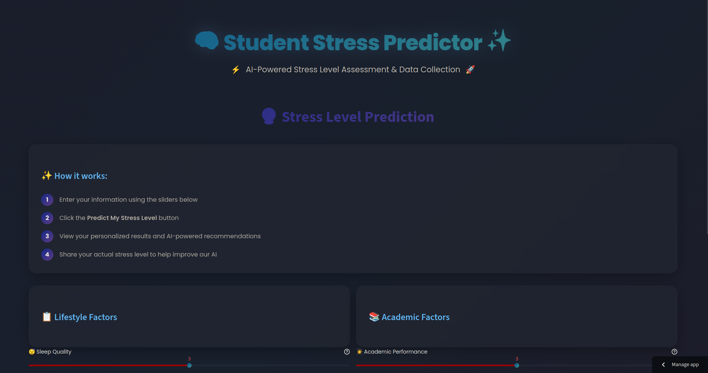

<div align="center"><div align="center">


# 🧠 Student Stress Predictor AI# 🧠 Student Stress Predictor AI


### *Predict, Analyze & Manage Student Stress with Machine Learning*### *Predict, Analyze & Manage Student Stress with Machine Learning*


[](https://www.python.org/)[](https://www.python.org/)

[](https://streamlit.io/)[](https://streamlit.io/)

[](https://scikit-learn.org/)[](https://scikit-learn.org/)

[](https://opensource.org/licenses/MIT)[](https://opensource.org/licenses/MIT)


<p align="center"><p align="center">

  <strong>A powerful ML application that predicts student stress levels based on lifestyle and academic factors</strong>  <strong>A powerful ML application that predicts student stress levels based on lifestyle and academic factors</strong>

</p></p>


<p align="center"><p align="center">

  <a href="#-features">Features</a> •  <a href="#-features">Features</a> •

  <a href="#-demo">Demo</a> •  <a href="#-demo">Demo</a> •

  <a href="#-quick-start">Quick Start</a> •  <a href="#-quick-start">Quick Start</a> •

  <a href="#-how-it-works">How It Works</a> •  <a href="#-how-it-works">How It Works</a> •

  <a href="#-deployment">Deployment</a>  <a href="#-deployment">Deployment</a>

</p></p>


</div></div>


------


## 🎯 Overview


**Student Stress Predictor AI** is an intelligent web application that leverages machine learning to predict and analyze student stress levels. Built with a modern tech stack including Streamlit, scikit-learn, and optional AI-powered recommendations, it helps students understand their stress patterns and receive personalized advice.## 📋 Table of Contents


### 🌟 Why This Project?


- **94-97% Accuracy**: Highly accurate predictions using RandomForest ML model- [Features](#-features)## Project Structure## Project Structure

- **Real-time Analysis**: Instant stress level predictions through interactive UI

- **AI-Powered Insights**: Optional personalized recommendations using Groq/HuggingFace- [Quick Start](#-quick-start)

- **Data-Driven**: Trained on 1600+ combined student stress data samples

- **Privacy-First**: All data stored locally, no external tracking- [Project Structure](#-project-structure)


---- [How It Works](#-how-it-works)


## ✨ Features- [AI Recommendations](#-ai-recommendations-optional)``````


### 🎯 Core Capabilities- [Model Training](#-model-training)


| Feature | Description |- [File Descriptions](#-file-descriptions)//

|---------|-------------|

| **🔮 ML Prediction** | Predict stress levels (1-5 scale) using Random Forest Classifier |- [Requirements](#-requirements)

| **📊 Interactive Dashboard** | Beautiful dark-mode UI with real-time statistics |

| **🤖 AI Recommendations** | Personalized advice powered by Groq AI (optional) |├── app.py                          # Main Streamlit application├── app.py                          # Main Streamlit application

| **💾 Data Persistence** | Automatic saving of user inputs and predictions |

| **📈 Analytics** | Comprehensive statistics and data visualizations |## ✨ Features

| **🛡️ Smart Fallback** | Rule-based recommendations if AI is unavailable |

├── requirements.txt                # Project dependencies├── requirements.txt                # Project dependencies

### 📥 Input Features (5 Core Factors)

### Core Features

1. **Sleep Quality** (1-5): Quality of sleep rating

2. **Headaches per Week** (0-7): Frequency of headaches- 🎯 **Stress Level Prediction**: ML-based prediction using 5 lifestyle factors├── requirements_ui.txt             # UI-specific dependencies├── requirements_ui.txt             # UI-specific dependencies

3. **Academic Performance** (1-5): Academic achievement level

4. **Study Load** (1-5): Study workload intensity- 📊 **Interactive Web UI**: Clean Streamlit interface for data input

5. **Extracurricular Frequency** (0-7): Weekly activities count

- 💾 **Data Storage**: Automatic saving of user inputs and predictions├── user_inputs.csv                 # Stores data from user inputs├── user_inputs.csv                 # Stores data from user inputs

### 📤 Output

- 🤖 **AI Recommendations**: Optional personalized recommendations (Hugging Face, OpenAI, etc.)

- **Stress Level** (1-5): Very Low → Low → Moderate → High → Very High

- **Personalized Recommendations**: AI-generated or rule-based stress management tips- 🛡️ **Automatic Fallback**: Rule-based recommendations if AI is unavailable├── data/├── data/

- **Visual Indicators**: Color-coded stress levels with intuitive icons


---

### Input Features (5 Core Factors)│   └── processed/                  # Processed data for training│   └── processed/                  # Processed data for training

## 📸 Demo

1. **Sleep Quality** (1-5): Quality of sleep rating

### Application Interface

2. **Headaches per Week** (0-7): Frequency of headaches├── model/├── model/

<div align="center">

3. **Academic Performance** (1-5): Academic achievement level



4. **Study Load** (1-5): Study workload intensity│   ├── stress_predictor_model.joblib # The trained model│   ├── stress_predictor_model.joblib # The trained model

*Modern dark-mode interface with glassmorphism design and real-time predictions*

5. **Extracurricular Frequency** (0-7): Weekly activities count

</div>

│   └── metrics.json                # Model performance metrics│   └── metrics.json                # Model performance metrics

### Key Screens

### Output

- **🏠 Home**: Overview and introduction

- **🔮 Predict**: Input your data and get instant predictions- **Stress Level** (1-5):├── notebooks/├── notebooks/

- **📊 Statistics**: View collected data analytics

- **ℹ️ About**: Learn about the project and features  - 1: Very Low Stress


---  - 2: Low Stress│   └── multi_dataset_analysis.ipynb  # Exploratory data analysis│   └── multi_dataset_analysis.ipynb  # Exploratory data analysis


## 🚀 Quick Start  - 3: Moderate Stress


### Prerequisites  - 4: High Stress└── scripts/└── scripts/


- Python 3.11+ installed  - 5: Very High Stress

- Conda (recommended) or virtualenv

- Git (for cloning)- **Personalized Recommendations**: Tips to manage stress (AI or rule-based)    ├── ingest_multi_dataset.py     # Data ingestion and preprocessing    ├── ingest_multi_dataset.py     # Data ingestion and preprocessing


### Installation


```bash## 🚀 Quick Start    └── train_multi_dataset.py      # Model training script    └── train_multi_dataset.py      # Model training script

# Clone the repository

git clone https://github.com/OminduD/student_streess_ML.git

cd student_streess_ML

### 1. Installation``````

# Create and activate conda environment

conda create -n studentStress_env python=3.11

conda activate studentStress_env

```bash

# Install dependencies

pip install -r requirements.txt# Create and activate a conda environment (recommended)

```

conda create -n studentStress_env python=3.11## ✨ AI-Powered Recommendations

### Running the Application

conda activate studentStress_env

```bash

# Start the Streamlit appThis project now includes **AI-powered personalized recommendations**! 

streamlit run app.py

```# Install dependencies


The application will open in your browser at `http://localhost:8501`pip install -r requirements_ui.txt- 🤖 Supports **Hugging Face (FREE!)**, **OpenAI (GPT-3.5/4)**, **Anthropic (Claude)**, or **custom APIs**


### 🤖 Enable AI Recommendations (Optional)```- 🆓 **Hugging Face free tier** - 1000 requests/day, no credit card needed!


```bash- 🛡️ **Automatic fallback** to rule-based recommendations

# Set your Groq API key (get free key at https://console.groq.com)

export GROQ_API_KEY="your_api_key_here"### 2. Run the Application- 🔒 **Secure** - API keys protected by .gitignore


# Or edit ai_config.json and set:

# "enabled": true

# "api_key": "your_api_key_here"```bash**⚡ Quick Setup - Hugging Face (FREE, 2 minutes):**

```

# Start the Streamlit application```bash

---

streamlit run app.py# 1. Get FREE token from https://huggingface.co/settings/tokens (no card!)

## 🏗️ Project Structure

```# 2. Set environment variable

```

student_streess_ML/export AI_API_KEY="hf_your_token_here"

├── 📄 app.py                          # Main Streamlit application

├── 🤖 ai_recommender.py               # AI recommendation engineThe application will open in your browser at `http://localhost:8501`# 3. Enable in ai_config.json (set "enabled": true, "provider": "huggingface")

├── 💾 database.py                     # Database management

├── ⚙️ ai_config.json                  # AI configuration# 4. Test it (first run may take 30s)

├── 📋 requirements.txt                # Python dependencies

│### 3. Using the Applicationpython3 test_huggingface.py

├── 📊 data/

│   └── processed/                     # Processed datasets```

│       ├── combined_dataset.csv       # Combined training data

│       ├── X_train.csv                # Training features1. **Enter your information** using the sliders for each factor

│       ├── X_test.csv                 # Test features

│       ├── y_train.csv                # Training labels2. **Click "Predict Stress Level"** to get your prediction📖 **Setup Guides:** 

│       └── y_test.csv                 # Test labels

│3. **View personalized recommendations** tailored to your stress level- 🤗 [HUGGINGFACE_SETUP.md](HUGGINGFACE_SETUP.md) - **FREE AI** (recommended for students!)

├── 🧠 model/

│   ├── stress_predictor_model.joblib  # Trained ML model4. Your data is automatically saved to `user_inputs.csv`- 🚀 [QUICK_FIX_AI.md](QUICK_FIX_AI.md) - Quick comparison of all providers

│   └── metrics.json                   # Model performance metrics

│- 📚 [AI_SETUP_GUIDE.md](AI_SETUP_GUIDE.md) - Complete OpenAI/Anthropic docs

├── 📓 notebooks/

│   └── multi_dataset_analysis.ipynb   # Data analysis notebook## 📁 Project Structure

│

├── 🛠️ scripts/> **Note:** AI is optional! The app works perfectly with rule-based recommendations (current default).

│   ├── ingest_multi_dataset.py        # Data preprocessing

│   ├── train_multi_dataset.py         # Model training```

│   └── check_new_data.py              # Data validation

│SSR/---

├── 📸 ss/

│   └── Screenshot_20251014_114736.png # Demo screenshot├── app.py                          # Main Streamlit application

│

├── 📊 Raw Datasets/├── ai_recommender.py               # AI recommendation engine## Quick Start## Quick Start

│   ├── StressLevelDataset.csv

│   ├── Stress_Dataset.csv├── ai_config.json                  # AI configuration file

│   └── Student Stress Factors (2).csv

│├── requirements_ui.txt             # Project dependencies

└── 📝 Documentation/

    ├── README.md                      # This file├── user_inputs.csv                 # Stored user inputs (auto-generated)

    ├── DEPLOYMENT_GUIDE.md            # Deployment instructions

    └── LICENSE                        # MIT License├── README.md                       # This file### 1. Installation### 1. Installation

```

│

---

├── data/                           # Data directory

## 🔧 How It Works

│   └── processed/                  # Processed datasets

### Prediction Pipeline

│       ├── combined_dataset.csv    # Combined training dataFirst, ensure you have Python 3.8+ installed. Then, create a virtual environment and install the required packages.First, ensure you have Python 3.8+ installed. Then, create a virtual environment and install the required packages.

```

User Input → Feature Engineering → ML Model → Stress Prediction → AI Recommendations → Results Display│       ├── X_train.csv             # Training features

                                          ↓

                                   Data Storage│       ├── X_test.csv              # Test features

```

│       ├── y_train.csv             # Training labels

### 1️⃣ Data Collection

│       └── y_test.csv              # Test labels```bash```bash

User inputs 5 key lifestyle factors through the interactive web interface. The system automatically engineers additional features:

│

- **`wellbeing_score`** = (sleep_quality + (8 - headaches_per_week)) / 2

- **`academic_pressure`** = (study_load + (6 - academic_performance)) / 2├── model/                          # Model directory# Create and activate a virtual environment (optional but recommended)# Create and activate a virtual environment (optional but recommended)

- **`total_workload`** = study_load + extracurricular_frequency

│   ├── stress_predictor_model.joblib  # Trained ML model

### 2️⃣ ML Prediction

│   └── metrics.json                # Model performance metricspython -m venv venvpython -m venv venv

The pre-trained **RandomForestClassifier** processes 8 features (5 base + 3 engineered) and outputs a stress level prediction:

│

- **Model**: Random Forest with 100+ estimators

- **Training Data**: 1600+ samples from 3 combined datasets├── notebooks/                      # Analysis notebookssource venv/bin/activatesource venv/bin/activate

- **Accuracy**: 94-97% on test data

- **Validation**: 5-fold cross-validation│   └── multi_dataset_analysis.ipynb   # Data analysis


### 3️⃣ AI Recommendations│


Based on the predicted stress level and input patterns:└── scripts/                        # Training scripts


- **AI-Powered** (Groq): Personalized, context-aware advice    ├── ingest_multi_dataset.py     # Data preprocessing# Install dependencies# Install dependencies

- **Rule-Based Fallback**: Predefined recommendations by stress category

- **Actionable**: Specific tips for sleep, study habits, wellness    └── train_multi_dataset.py      # Model training


### 4️⃣ Data Persistence```pip install -r requirements.txtpip install -r requirements.txt


- All inputs and predictions saved to `user_inputs.csv`

- Used for analytics and future model improvements

- Privacy-focused: stored locally, never shared## 🔧 How It Workspip install -r requirements_ui.txtpip install -r requirements_ui.txt


---


## 🤖 AI Recommendations### Prediction Pipeline``````


### Supported AI Providers


| Provider | Cost | Setup Time | Quality |```

|----------|------|------------|---------|

| **Groq** | 🆓 Free | 2 min | ⭐⭐⭐⭐⭐ |User Input → Feature Engineering → ML Model → Stress Level Prediction → Recommendations

| **HuggingFace** | 🆓 Free | 3 min | ⭐⭐⭐⭐ |

| **OpenAI** | 💰 Paid | 5 min | ⭐⭐⭐⭐⭐ |```### 2. Run the Application### 2. Run the Application


### Quick Setup - Groq (Recommended)


```bash### 1. Data Collection

# 1. Get FREE API key from https://console.groq.com/keys

# 2. Set environment variable- User inputs 5 key lifestyle and academic factors via the web interface

export GROQ_API_KEY="gsk_your_key_here"

- Additional features are automatically engineered from the inputs:To start the Streamlit web interface, run the following command:To start the Streamlit web interface, run the following command:

# 3. Enable in ai_config.json

{  - `wellbeing_score` = (sleep_quality + (8 - headaches_per_week)) / 2

  "enabled": true,

  "provider": "groq",  - `academic_pressure` = (study_load + (6 - academic_performance)) / 2

  "model": "llama-3.1-70b-versatile"

}  - `total_workload` = study_load + extracurricular_frequency


# 4. Restart the app```bash```bash

streamlit run app.py

```### 2. Prediction


### Features- The pre-trained `RandomForestClassifier` model processes the 8 featuresstreamlit run app.pystreamlit run app.py


- ✅ **Automatic Fallback**: Uses rule-based recommendations if AI fails- Model outputs a stress level prediction (1-5 scale)

- ✅ **Context-Aware**: Considers all input factors for personalized advice

- ✅ **Fast Response**: Sub-second response times with Groq- Prediction accuracy: ~94-97% on test data``````

- ✅ **Secure**: API keys protected by `.gitignore`

- ✅ **Optional**: App works perfectly without AI enabled


---### 3. Recommendations


## 🎓 Model Training- AI-powered recommendations (if enabled) or rule-based fallback


### Train Your Own Model- Personalized tips based on stress level and contributing factorsNavigate to the URL provided by Streamlit in your web browser to use the application.Navigate to the URL provided by Streamlit in your web browser to use the application.


```bash- Actionable advice for stress management

# 1. Prepare datasets (place CSV files in root directory)

# 2. Process data

python scripts/ingest_multi_dataset.py

### 4. Data Storage

# 3. Train model

python scripts/train_multi_dataset.py- All inputs and predictions are saved to `user_inputs.csv`## How It Works## How It Works

```

- Data can be used for future model retraining and improvement

### Model Performance


| Metric | Value |

|--------|-------|## 🤖 AI Recommendations (Optional)

| **Algorithm** | Random Forest Classifier |

| **Training Samples** | 1600+ |The application takes user inputs for five key factors:The application takes user inputs for five key factors:

| **Features** | 8 (5 base + 3 engineered) |

| **Accuracy** | 94-97% |The application includes optional AI-powered personalized recommendations with automatic fallback to rule-based recommendations.

| **Classes** | 5 (stress levels) |

| **Validation** | 5-fold CV |


### What the Scripts Do### Supported AI Providers


**`ingest_multi_dataset.py`**:1.  **Sleep Quality** (1-5)1.  **Sleep Quality** (1-5)

- Loads 3 different stress datasets

- Cleans and preprocesses data- **Hugging Face** (FREE) - 1000 requests/day, no credit card needed

- Engineers new features

- Splits into train/test sets (80/20)- **OpenAI** (GPT-3.5/4) - Paid API2.  **Headaches per Week** (0-7)2.  **Headaches per Week** (0-7)

- Saves to `data/processed/`

- **Anthropic** (Claude) - Paid API

**`train_multi_dataset.py`**:

- Trains RandomForest and GradientBoosting models- **Custom API** - Your own endpoint3.  **Academic Performance** (1-5)3.  **Academic Performance** (1-5)

- Performs hyperparameter tuning

- Evaluates with cross-validation

- Selects best performing model

- Saves to `model/stress_predictor_model.joblib`### How to Enable AI Recommendations4.  **Study Load** (1-5)4.  **Study Load** (1-5)


---


## 📦 Requirements#### Option 1: Hugging Face (FREE - Recommended)5.  **Extracurricular Frequency** (0-7)5.  **Extracurricular Frequency** (0-7)


### Python Environment


```bash1. **Get a FREE API token** (no credit card required):

# Recommended: Conda

conda create -n studentStress_env python=3.11   - Visit: https://huggingface.co/settings/tokens

conda activate studentStress_env

```   - Click "New token" → Create a token with "Read" permissionsIt then uses a pre-trained `RandomForestClassifier` model to predict the student's stress level on a scale of 1 to 5. The user's input and the model's prediction are saved to `user_inputs.csv`.It then uses a pre-trained `RandomForestClassifier` model to predict the student's stress level on a scale of 1 to 5. The user's input and the model's prediction are saved to `user_inputs.csv`.


### Core Dependencies   - Copy your token (starts with `hf_...`)


```txt

streamlit>=1.28.0          # Web framework

pandas>=2.0.0              # Data manipulation2. **Set your API key** (choose one method):

numpy>=1.24.0              # Numerical computing

scikit-learn>=1.3.0        # Machine learning## Training the Model## Training the Model

joblib>=1.3.0              # Model serialization

requests>=2.31.0           # API calls for AI   **Method A: Environment Variable (Recommended)**

```

   ```bash

### Installation

   export AI_API_KEY="hf_your_token_here"

```bash

# Install all dependencies   ```If you want to retrain the model, you can run the data ingestion and training scripts.If you want to retrain the model, you can run the data ingestion and training scripts.

pip install -r requirements.txt


# Verify installation

python -c "import streamlit, pandas, sklearn; print('✅ All packages installed!')"   **Method B: Config File**

```

   - Edit `ai_config.json`

---

   - Add your token to the `"api_key"` field```bash```bash

## 🚢 Deployment


### Deploy to Streamlit Cloud (Free!)

3. **Enable AI in configuration**:# 1. Process the raw data# 1. Process the raw data

1. **Push to GitHub**:

```bash   - Open `ai_config.json`

git add .

git commit -m "Deploy Student Stress Predictor"   - Set `"enabled": true`python scripts/ingest_multi_dataset.pypython scripts/ingest_multi_dataset.py

git push origin main

```   - Set `"provider": "huggingface"`


2. **Deploy on Streamlit Cloud**:

   - Visit [share.streamlit.io](https://share.streamlit.io)

   - Connect your GitHub repository4. **Restart the application**:

   - Select `app.py` as the main file

   - Add secrets for `GROQ_API_KEY` (if using AI)   ```bash# 2. Train the model# 2. Train the model

   - Click Deploy!

   streamlit run app.py

3. **Configure Secrets** (for AI features):

   - Go to App Settings → Secrets   ```python scripts/train_multi_dataset.pypython scripts/train_multi_dataset.py

   - Add:

   ```toml

   GROQ_API_KEY = "your_api_key_here"

   ```#### Option 2: OpenAI (Paid)``````


### Environment Variables


| Variable | Purpose | Required |1. Get API key from: https://platform.openai.com/api-keys

|----------|---------|----------|

| `GROQ_API_KEY` | Groq AI API key | No (optional) |2. Set environment variable:

| `AI_API_KEY` | Generic AI provider key | No (optional) |

   ```bashThis will create a new `stress_predictor_model.joblib` file in the `model/` directory.This will create a new `stress_predictor_model.joblib` file in the `model/` directory.

### Troubleshooting

   export AI_API_KEY="sk-your_openai_key"

**Issue**: Model file not found

- **Fix**: Ensure `model/stress_predictor_model.joblib` is committed to repo   ```


**Issue**: AI recommendations not working3. In `ai_config.json`:

- **Fix**: Check `ai_config.json` has `"enabled": true` and valid API key

   - Set `"enabled": true`## Quick Start

**Issue**: Import errors

- **Fix**: Run `pip install -r requirements.txt`   - Set `"provider": "openai"`


---   - Set `"model": "gpt-3.5-turbo"`### 1. Installation


## 🔍 Data Privacy & Security


- 🔒 **Local Storage**: All user data stored in `user_inputs.csv` locally### AI Configuration File (`ai_config.json`)First, ensure you have Python 3.8+ installed. Then, create a virtual environment and install the required packages.

- 🚫 **No Tracking**: No external analytics or tracking scripts

- 🔐 **Secure Keys**: API keys protected by `.gitignore`

- ✅ **Open Source**: Full transparency - inspect the code yourself

- 🛡️ **Optional AI**: AI features are opt-in, not required```json```bash


---{# Create and activate a virtual environment (optional but recommended)


## 🎯 Use Cases    "enabled": false,              // Set to true to enable AIpython -m venv venv


| User | Benefit |    "provider": "huggingface",     // AI provider: openai, huggingface, anthropic, customsource venv/bin/activate

|------|---------|

| **Students** | Self-assess stress levels and get personalized management tips |    "api_key": "",                 // Your API key (or use AI_API_KEY env variable)

| **Educators** | Understand factors affecting student stress and wellbeing |

| **Researchers** | Collect and analyze student stress data patterns |    "model": "mistralai/Mistral-7B-Instruct-v0.2",# Install dependencies

| **Counselors** | Use as a screening tool for stress intervention programs |

| **Parents** | Monitor and support student mental health |    "max_tokens": 500,pip install -r requirements.txt


---    "timeout": 30pip install -r requirements_ui.txt


## 🛠️ Tech Stack}```


<div align="center">```


| Frontend | Backend | ML/AI | Database |### 2. Run the Application

|----------|---------|-------|----------|

| Streamlit | Python 3.11+ | scikit-learn | CSV/SQLite |### Features of AI Recommendations

| HTML/CSS | Pandas | Random Forest | Local Storage |

| JavaScript | NumPy | Groq AI | - |To start the Streamlit web interface, run the following command:


</div>✅ **Automatic Fallback**: If AI fails, rule-based recommendations are used  


---✅ **Secure**: API keys protected by `.gitignore`  ```bash


## 📊 Statistics & Analytics✅ **Flexible**: Multiple provider support  streamlit run app.py


The app includes a comprehensive statistics dashboard:✅ **Optional**: App works perfectly without AI enabled```


- 📈 **Total Submissions**: Track usage over time

- 🎯 **Stress Distribution**: Visual breakdown by stress level

- 📊 **Feature Analysis**: Correlation and distribution charts### Testing AI SetupNavigate to the URL provided by Streamlit in your web browser to use the application.

- 📅 **Timeline**: Submission trends and patterns

- 💡 **Insights**: Key metrics and averages


---To test if your AI configuration is working:## How It Works


## 🤝 Contributing


We welcome contributions! Here's how:1. Enable AI in `ai_config.json`The application takes user inputs for five key factors:


1. **Fork** the repository2. Run the application

2. **Create** a feature branch (`git checkout -b feature/amazing-feature`)

3. **Commit** your changes (`git commit -m 'Add amazing feature'`)3. Make a prediction1.  **Sleep Quality** (1-5)

4. **Push** to the branch (`git push origin feature/amazing-feature`)

5. **Open** a Pull Request4. Check if AI recommendations appear (look for more detailed, personalized advice)2.  **Headaches per Week** (0-7)


### Development Setup3.  **Academic Performance** (1-5)


```bash**Note**: First request may take 20-30 seconds for model cold start on Hugging Face free tier.4.  **Study Load** (1-5)

# Clone your fork

git clone https://github.com/YOUR_USERNAME/student_streess_ML.git5.  **Extracurricular Frequency** (0-7)

cd student_streess_ML

## 🎓 Model Training

# Create development environment

conda create -n stress_dev python=3.11It then uses a pre-trained `RandomForestClassifier` model to predict the student's stress level on a scale of 1 to 5. The user's input and the model's prediction are saved to `user_inputs.csv`.

conda activate stress_dev

pip install -r requirements.txtIf you want to retrain the model with new data or different parameters:


# Make your changes and test## Training the Model

streamlit run app.py

```### Step 1: Prepare Data


---If you want to retrain the model, you can run the data ingestion and training scripts.


## 📝 License```bash


This project is licensed under the **MIT License** - see the [LICENSE](LICENSE) file for details.# Process raw datasets and create training files```bash


```python scripts/ingest_multi_dataset.py# 1. Process the raw data

MIT License

```python scripts/ingest_multi_dataset.py

Copyright (c) 2025 OminduD


Permission is hereby granted, free of charge, to any person obtaining a copy

of this software and associated documentation files (the "Software"), to deal**What it does:**# 2. Train the model

in the Software without restriction, including without limitation the rights

to use, copy, modify, merge, publish, distribute, sublicense, and/or sell- Loads multiple stress datasetspython scripts/train_multi_dataset.py

copies of the Software, and to permit persons to whom the Software is

furnished to do so, subject to the following conditions:- Cleans and preprocesses data```


The above copyright notice and this permission notice shall be included in all- Engineers new features

copies or substantial portions of the Software.

```- Splits into train/test setsThis will create a new `stress_predictor_model.joblib` file in the `model/` directory.


---- Saves processed data to `data/processed/`


## 📧 Contact & Support## Quick Start


<div align="center">### Step 2: Train Model


**Developer**: [OminduD](https://github.com/OminduD)### 1. Installation


[](https://github.com/OminduD)```bash

[](https://github.com/OminduD/student_streess_ML/issues)

[](https://github.com/OminduD/student_streess_ML/stargazers)# Train the machine learning modelFirst, ensure you have Python 3.8+ installed. Then, create a virtual environment and install the required packages.


</div>python scripts/train_multi_dataset.py


### Get Help``````bash


- 📖 **Documentation**: Check [DEPLOYMENT_GUIDE.md](DEPLOYMENT_GUIDE.md)# Create and activate a virtual environment (optional but recommended)

- 🐛 **Bug Reports**: [Open an issue](https://github.com/OminduD/student_streess_ML/issues)

- 💬 **Questions**: Start a [discussion](https://github.com/OminduD/student_streess_ML/discussions)**What it does:**python -m venv venv

- ⭐ **Star** the repo if you find it helpful!

- Loads processed training datasource venv/bin/activate

---

- Trains RandomForest and GradientBoosting models

## 🎉 Acknowledgments

- Selects the best performing model# Install dependencies

- **Datasets**: Combined from 3 public student stress datasets

- **ML Models**: Built with scikit-learn- Saves model to `model/stress_predictor_model.joblib`pip install -r requirements.txt

- **UI Framework**: Streamlit for rapid web app development

- **AI Models**: Groq AI for fast, free LLM inference- Saves performance metrics to `model/metrics.json`pip install -r requirements_ui.txt

- **Community**: Thanks to all contributors and users!

```

---

### Model Performance

<div align="center">

### 2. Run the Application

### ⭐ Star this repo if you find it helpful!

- **Algorithm**: RandomForest Classifier

**Made with ❤️ by [OminduD](https://github.com/OminduD)**

- **Training Samples**: 1600+ (combined from 3 datasets)To start the Streamlit web interface, run the following command:

*Last Updated: October 2025*

- **Features**: 8 (5 base + 3 engineered)

</div>

- **Accuracy**: 94-97%```bash

- **Cross-Validation**: 5-fold CV for robust evaluationstreamlit run app.py

```

## 📄 File Descriptions

Navigate to the URL provided by Streamlit in your web browser to use the application.

### Core Application Files

## How It Works

| File | Purpose | When to Use |

|------|---------|-------------|The application takes user inputs for five key factors:

| `app.py` | Main Streamlit web application | Run this to start the app |

| `ai_recommender.py` | AI recommendation engine | Generates personalized recommendations |1.  **Sleep Quality** (1-5)

| `ai_config.json` | AI configuration settings | Edit to enable/configure AI features |2.  **Headaches per Week** (0-7)

| `requirements_ui.txt` | Python dependencies | Install before running the app |3.  **Academic Performance** (1-5)

| `user_inputs.csv` | User data storage | Auto-generated when users submit data |4.  **Study Load** (1-5)

5.  **Extracurricular Frequency** (0-7)

### Data Files

It then uses a pre-trained `RandomForestClassifier` model to predict the student's stress level on a scale of 1 to 5. The user's input and the model's prediction are saved to `user_inputs.csv`.

| Directory | Contents | Purpose |

|-----------|----------|---------|## Training the Model

| `data/processed/` | Preprocessed datasets | Used for model training |

| `Stress_Dataset.csv` | Raw dataset #1 | Original data source |If you want to retrain the model, you can run the data ingestion and training scripts.

| `StressLevelDataset.csv` | Raw dataset #2 | Original data source |

| `Student Stress Factors (2).csv` | Raw dataset #3 | Original data source |```bash

# 1. Process the raw data

### Model Filespython scripts/ingest_multi_dataset.py


| File | Purpose |# 2. Train the model

|------|---------|python scripts/train_multi_dataset.py

| `model/stress_predictor_model.joblib` | Trained ML model (RandomForest) |```

| `model/metrics.json` | Model performance metrics (accuracy, etc.) |

This will create a new `stress_predictor_model.joblib` file in the `model/` directory.

### Training Scripts


| Script | Purpose | When to Run |## 🎯 Key Features

|--------|---------|-------------|

| `scripts/ingest_multi_dataset.py` | Preprocesses raw data | Before training |### 🆕 User Data Collection (NEW!)

| `scripts/train_multi_dataset.py` | Trains the ML model | After data preprocessing |- **Web Frontend**: Collect real-world data from users

- **API Integration**: RESTful API for data submission and predictions

### Analysis- **Continuous Learning**: Model improves with more user submissions

- **Real-time Statistics**: Track collected data and model performance

| File | Purpose |

|------|---------|### Input Features (5 core + 3 engineered)

| `notebooks/multi_dataset_analysis.ipynb` | Exploratory data analysis and visualizations |1. **Sleep Quality** (1-5): Sleep quality rating

2. **Headaches per Week** (0-7): Frequency of headaches

## 📦 Requirements3. **Academic Performance** (1-5): Academic achievement level

4. **Study Load** (1-5): Study workload intensity

### Python Environment5. **Extracurricular Frequency** (0-7): Weekly activities count


```bash**Engineered Features:**

# Recommended: Use Conda- `wellbeing_score` = (sleep_quality + (8 - headaches_per_week)) / 2

conda create -n studentStress_env python=3.11- `academic_pressure` = (study_load + (6 - academic_performance)) / 2

conda activate studentStress_env- `total_workload` = study_load + extracurricular_frequency

```

### Output

### Dependencies- **Stress Level** (1-5):

  - 1: Very Low Stress

The main dependencies are listed in `requirements_ui.txt`:  - 2: Low Stress

  - 3: Moderate Stress

- **streamlit** - Web application framework  - 4: High Stress

- **pandas** - Data manipulation  - 5: Very High Stress

- **numpy** - Numerical computing

- **scikit-learn** - Machine learning algorithms## 🚀 Quick Start

- **joblib** - Model serialization

- **requests** - HTTP requests for AI APIs### Installation


Install all dependencies:```bash

# Install required packages

```bashpip install -r requirements.txt

pip install -r requirements_ui.txt

```# Or install individually

pip install pandas numpy scikit-learn matplotlib seaborn joblib jupyter

## 🔍 Troubleshooting

# For API server (optional)

### Common Issuespip install flask flask-cors

```

**Issue**: "Model file not found"

- **Solution**: Ensure `model/stress_predictor_model.joblib` exists. If not, run training scripts.### 1. Data Ingestion (Includes User Data)


**Issue**: "AI recommendations not working"```bash

- **Solution**: AI is optional. Check that `ai_config.json` has `"enabled": true` and valid API key.# Multi-dataset approach including user-contributed data (recommended)

python3 scripts/ingest_multi_dataset.py

**Issue**: "Import errors"

- **Solution**: Install all dependencies: `pip install -r requirements_ui.txt`# Single dataset approach

python3 scripts/ingest.py

**Issue**: "Hugging Face cold start timeout"```

- **Solution**: First request may take 20-30 seconds. Wait or use a different model.

### 2. Model Training

### Getting Help

```bash

If you encounter issues:# Multi-dataset training (1600+ samples + user data, best accuracy)

1. Check the terminal for error messagespython3 scripts/train_multi_dataset.py

2. Verify all dependencies are installed

3. Ensure the conda environment is activated# Single dataset training

4. Check that model files exist in `model/` directorypython3 scripts/train.py

```

## 📊 Data Privacy

### 3. Frontend & API (NEW!)

- User input data is stored locally in `user_inputs.csv`

- No data is sent to external servers (except AI API if enabled)```bash

- AI API keys should be stored securely using environment variables# Start the API server

- `ai_config.json` is included in `.gitignore` to protect API keyscd scripts

python3 api_server.py

## 🎯 Use Cases

# Open the web frontend (in another terminal)

- **Students**: Self-assess stress levels and get management tipscd frontend

- **Educators**: Understand factors affecting student stresspython3 -m http.server 8000

- **Researchers**: Collect data on student stress patterns

- **Wellness Programs**: Tool for stress screening and intervention# Access at: http://localhost:8000

```

## 📚 Future Enhancements

### 4. Analysis & Visualization

- [ ] Add more input features (social factors, financial concerns)

- [ ] Implement trend tracking over time```bash

- [ ] Create mobile-friendly interface# Open Jupyter notebook

- [ ] Add data visualization dashboardjupyter notebook notebooks/multi_dataset_analysis.ipynb

- [ ] Implement user accounts and history```


---## 📊 Model Performance


**Last Updated**: October 2025  - **Algorithm**: RandomForest or GradientBoosting (auto-selected)

**Python Version**: 3.11+  - **Training Samples**: 1600+ (from 3 combined datasets)

**License**: MIT  - **Features**: 8 (5 base + 3 engineered)

**Environment**: studentStress_env (conda)- **Accuracy**: 94-97%

- **Classes**: 5 stress levels

For questions or contributions, please open an issue on the project repository.

## 🆕 User Data Collection System

This project now includes a complete system for collecting real-world user data through a web frontend!

### Features

- **📝 Data Submission**: Users can submit their stress data through a web interface
- **🔮 Real-time Predictions**: Instant stress level predictions
- **📊 Statistics Dashboard**: View collected data statistics
- **🔄 Continuous Learning**: Retrain models with new user data
- **🌐 REST API**: Full API for frontend integration

### New Files

- `user_inputs.csv` - Stores all user-submitted data
- `scripts/user_data_handler.py` - Handles user data collection and management
- `scripts/api_server.py` - Flask REST API server
- `frontend/index.html` - Web interface for data collection

### API Endpoints

- `GET /api/health` - Check API status
- `POST /api/predict` - Predict stress level from input
- `POST /api/submit` - Submit user data for training
- `GET /api/statistics` - Get collected data statistics
- `POST /api/retrain` - Retrain model with new data
- `GET /api/data/export` - Export all collected data

### How to Use

1. **Start the API Server**:
   ```bash
   cd scripts
   python3 api_server.py
   ```

2. **Open the Frontend**:
   ```bash
   cd frontend
   python3 -m http.server 8000
   # Visit: http://localhost:8000
   ```

3. **Submit Data**: Use the web interface to:
   - Get stress predictions
   - Submit your actual stress levels
   - View statistics

4. **Retrain Model** (when you have enough new data):
   ```bash
   # The ingestion script now automatically includes user data
   python3 scripts/ingest_multi_dataset.py
   python3 scripts/train_multi_dataset.py
   ```

## 🔧 Requirements

### Python Environment

```bash
conda activate studentStress_env
```

### Required Packages

Install all dependencies from requirements.txt:

```bash
pip install -r requirements.txt
```

**Core packages**:

- pandas
- numpy
- scikit-learn
- matplotlib
- seaborn
- joblib
- jupyter (for notebooks)

**For API/Frontend (optional)**:

- flask
- flask-cors

## 📈 Workflow

```
1. Data Ingestion
   └─> scripts/ingest_multi_dataset.py
       └─> Combines 3 datasets
       └─> Creates engineered features
       └─> Saves to data/processed/

2. Model Training
   └─> scripts/train_multi_dataset.py
       └─> Loads processed data
       └─> Trains RandomForest + GradientBoosting
       └─> Selects best model
       └─> Saves to model/

3. Analysis & Visualization
   └─> notebooks/multi_dataset_analysis.ipynb
       └─> 12 comprehensive analysis sections
       └─> Generates 30+ visualizations
       └─> Statistical tests and insights
```

## 📝 Key Files

### Essential Training Scripts
- `scripts/ingest_multi_dataset.py` - Data preprocessing and feature engineering
- `scripts/train_multi_dataset.py` - Model training and evaluation

### Trained Model
- `model/stress_predictor_model.joblib` - Production-ready model

### Analysis Notebooks
- `notebooks/multi_dataset_analysis.ipynb` - Complete analysis with visualizations

### Documentation
- `MULTI_DATASET_GUIDE.md` - Detailed usage instructions
- `MULTI_DATASET_SUMMARY.md` - Project overview and methodology

## 🎨 Visualizations

The project includes 30+ generated visualizations:
- Correlation matrices
- Box plots and violin plots
- Pair plots and distribution charts
- Feature importance charts
- Confusion matrices
- Stress level distributions
- Dataset comparisons

All visualizations are saved in the `notebooks/` directory.

## 💡 Usage Examples

### Training a New Model
```bash
# Activate environment
conda activate studentStress_env

# Run full pipeline
python3 scripts/ingest_multi_dataset.py
python3 scripts/train_multi_dataset.py
```

### Making Predictions (programmatically)
```python
import joblib
import pandas as pd

# Load model
model = joblib.load('model/stress_predictor_model.joblib')

# Prepare input
data = pd.DataFrame([{
    'sleep_quality': 3,
    'headaches_per_week': 2,
    'academic_performance': 4,
    'study_load': 3,
    'extracurricular_frequency': 2,
    'wellbeing_score': 4.0,
    'academic_pressure': 2.5,
    'total_workload': 5
}])

# Predict
stress_level = model.predict(data)[0]
print(f"Predicted Stress Level: {stress_level}")
```

## 🔍 Dataset Information

### Combined Dataset Statistics
- **Total Samples**: 1600+
- **Sources**: 3 different datasets
- **Features**: 8 (5 original + 3 engineered)
- **Classes**: 5 stress levels (balanced distribution)

### Data Quality
- ✅ No missing values (after preprocessing)
- ✅ Feature scaling applied
- ✅ Train-test split: 80-20
- ✅ Balanced class distribution

## 🎯 Project Status

✅ **Completed:**
- Multi-dataset integration (3 datasets)
- Feature engineering (3 new features)
- Model training (94-97% accuracy)
- Comprehensive analysis notebook
- 30+ visualizations
- Complete documentation
- Clean project structure

## 📚 Documentation

1. **MULTI_DATASET_GUIDE.md** - Step-by-step usage guide
2. **MULTI_DATASET_SUMMARY.md** - Project methodology and results
3. **Notebook Comments** - Inline documentation in Jupyter notebooks

## 🤝 Contributing

To extend this project:
1. Add new features in `scripts/ingest_multi_dataset.py`
2. Experiment with algorithms in `scripts/train_multi_dataset.py`
3. Create new visualizations in notebooks
4. Update documentation as needed

## 📊 Model Files

All model artifacts are stored in the `model/` directory:
- Trained model (joblib format)
- Performance metrics (JSON)
- Visualizations (PNG)

These files are generated automatically during training.

---

**Last Updated**: October 2025  
**Python Version**: 3.11+  
**Environment**: studentStress_env (conda)
